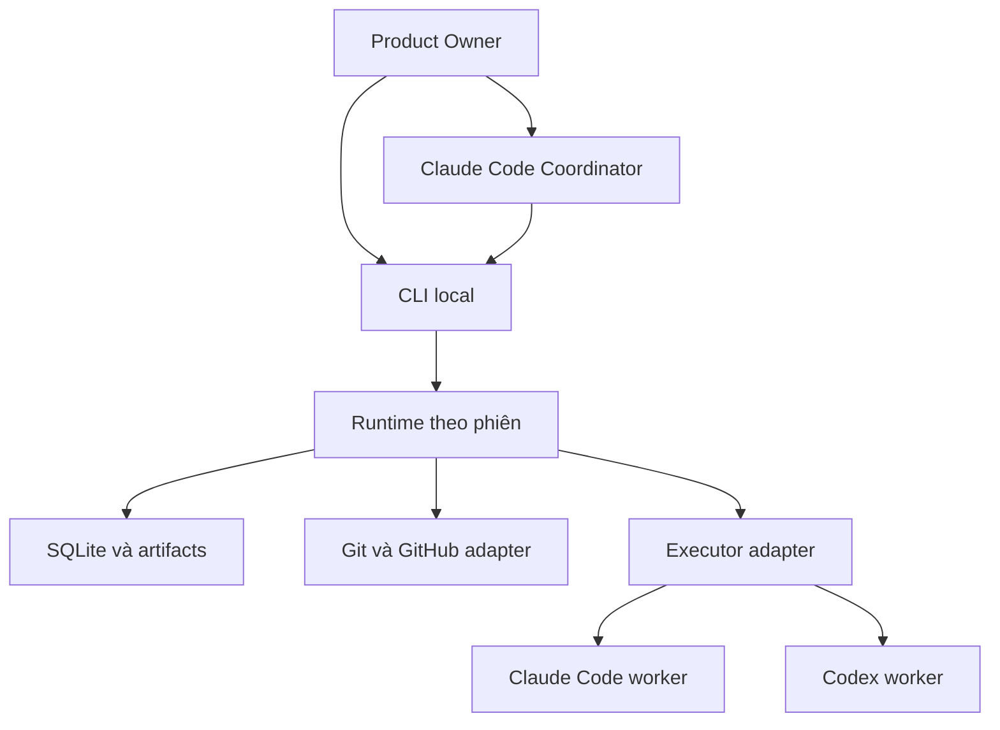
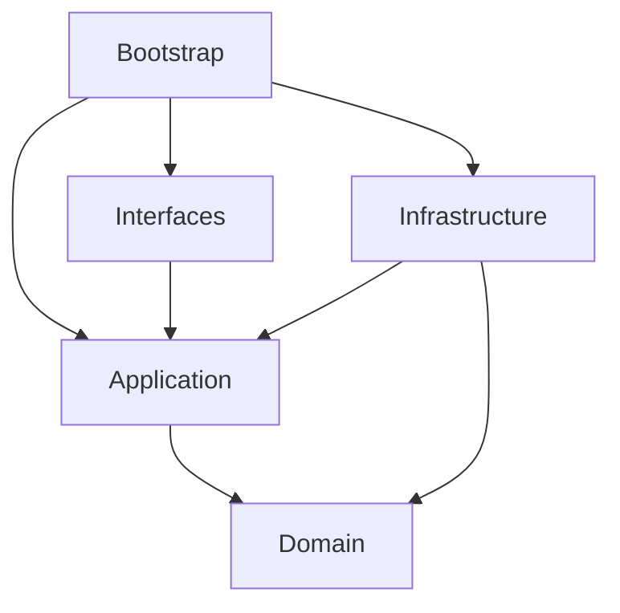
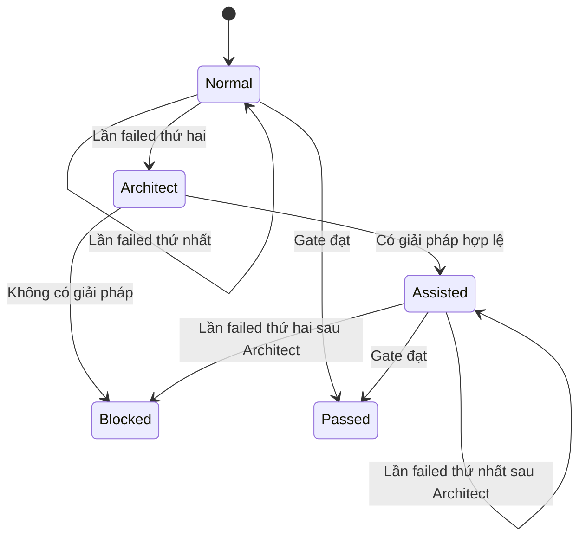

# omi-squad — Kiến trúc triển khai

Phiên bản 1.0 · 10/11/2026 · Tham chiếu: `product-overview.md`, `tech-stack.md`, `design-patterns.md`, `project-plan.md`.

## 1. Trạng thái và quyết định nền tảng

Đây là thiết kế đề xuất để triển khai, chưa phải mô tả một hệ thống đã chạy. Các yêu cầu của PO được giữ nguyên; các lựa chọn công nghệ dưới đây là quyết định kiến trúc có thể điều chỉnh qua ADR khi PoC cung cấp bằng chứng mới.

Chọn **modular monolith local**, TypeScript/Node.js, SQLite và các CLI adapter. Không dùng microservices, message broker hoặc server cloud. Một runtime gắn với một phiên Coordinator, một repository và một GitHub Project.

CLI là giao diện gọi chức năng. Runtime là process thực thi: quản lý worker, state, checkpoint, lock và đối soát GitHub. Coordinator là Claude Code chính đưa ra quyết định; không chuyển trách nhiệm suy luận sang một vòng LLM chạy nền khác.

## 2. Kiến trúc tổng thể



Luồng dữ liệu: Coordinator gửi một quyết định có cấu trúc; runtime kiểm tra schema/policy, lưu trạng thái rồi thực hiện. Worker trả kết quả có cấu trúc; runtime xác minh bằng chứng và trả tình trạng cho Coordinator. Coordinator quyết định bước tiếp theo nếu vượt ngoài kế hoạch đã được chấp thuận.

### Nguồn dữ liệu có thẩm quyền

| Dữ liệu | Nơi có thẩm quyền |
|---|---|
| Nội dung yêu cầu, priority, scope PO | GitHub Issue/Project và quyết định PO đã xác thực |
| Workflow, role, skills, rules | File version-controlled trong project |
| Run, step, attempt, lease, checkpoint | SQLite local |
| Code, commit, branch, merge | Git và GitHub |
| Kết quả CI/PR/release/deployment | Hệ thống thực hiện thực tế, được đối soát về local |
| Credential | Kho đăng nhập local của từng profile; không nằm trong SQLite |

Không dùng comment GitHub làm database runtime. Không dùng transcript Claude Code làm nguồn duy nhất để resume.

## 3. Cấu trúc repository phát triển framework

Repository này chứa mã nguồn **omi-squad**, khác với project sẽ cài framework. Mọi file mới phải thuộc một vùng dưới đây.

| Đường dẫn | Trách nhiệm | Không đặt tại đây |
|---|---|---|
| `src/domain/` | Entity, value object, trạng thái, invariant thuần | I/O, SDK, SQL, YAML parser, process |
| `src/application/` | Use case, port, contract và orchestration nghiệp vụ | Chi tiết GitHub HTTP, SQLite driver, terminal |
| `src/infrastructure/` | Adapter thực hiện I/O và port | Quy tắc nghiệp vụ tự phát, CLI handler |
| `src/interfaces/` | CLI, IPC protocol, formatter | SQL, spawn worker trực tiếp, domain policy |
| `src/bootstrap/` | Composition root, khởi tạo dependency và lifecycle | Nghiệp vụ, adapter implementation |
| `templates/project/` | Bộ cấu hình/workflow/role/skill/rule được cài vào project | Runtime state, secret, mã nghiệp vụ framework |
| `templates/bridges/` | Mẫu tích hợp Claude Code/Codex, hướng dẫn Coordinator | Bản sao logic điều phối |
| `migrations/` | Migration SQLite đánh số thứ tự | Migration database của project đích |
| `schemas/` | JSON Schema sinh từ contract, phục vụ CLI/agent | Schema viết tay trùng nguồn contract |
| `tests/` | Unit, integration, contract, E2E, fixtures | Mã production |
| `tools/` | Script phục vụ build, codegen, kiểm tra kiến trúc; dev tooling của Coordinator khi phát triển repo này (`tools/coordinator/`, tạm thời, thay bằng CLI `omi`; ADR-0014) | Chức năng người dùng đáng lẽ thuộc CLI |
| `docs/` | Tài liệu sản phẩm, kiến trúc, vận hành và ADR | Artifacts của một lần chạy agent |
| `.github/` | Issue/PR templates, workflow CI của framework | Profile subscription hoặc log |
| `.claude/` | Chỉ dẫn phát triển framework cho Claude Code | Bản cài omi-squad của project khác |
| `dist/` | JavaScript build, generated; gitignored | File chỉnh tay |
| `coverage/`, `.tmp/` | Kết quả test/tạm; gitignored | Nguồn cần version-control |

Root chỉ có file entry/config chuẩn: `package.json`, `package-lock.json`, `tsconfig*.json`, `eslint.config.js`, `vitest.config.ts`, `.dependency-cruiser.cjs`, `.nvmrc`, `.gitignore`, `.npmrc`, `README.md`, `AGENTS.md`, `CLAUDE.md`, `LICENSE`, `CHANGELOG.md`. Thêm root file ngoài danh sách cần cập nhật quy ước kiến trúc trước.

### 3.1. Domain

| Thư mục | File tiêu biểu | Trách nhiệm |
|---|---|---|
| `src/domain/tasks/` | `task.ts`, `task-status.ts`, `dependency-policy.ts` | Task, phạm vi và dependency |
| `src/domain/workflows/` | `workflow.ts`, `step.ts`, `workflow-policy.ts` | Đồ thị workflow và gate |
| `src/domain/runs/` | `workflow-run.ts`, `step-run.ts`, `retry-policy.ts` | State machine, 2 + Architect + 2 |
| `src/domain/agents/` | `role.ts`, `capability.ts`, `selection-policy.ts` | Năng lực và eligibility |
| `src/domain/profiles/` | `profile-state.ts`, `availability-policy.ts` | Khả dụng/cooldown, không chứa token |
| `src/domain/approvals/` | `approval.ts`, `approval-policy.ts` | Scope/revision/hiệu lực phê duyệt |
| `src/domain/delivery/` | `merge-policy.ts`, `release-policy.ts` | Điều kiện merge/release/deploy |
| `src/domain/shared/` | `ids.ts`, `domain-error.ts`, `result.ts` | Primitive dùng thật sự ở nhiều module |

Không tạo `common/`, `helpers/`, `utils/`, `manager.ts` chung chung. Hàm chỉ dùng cho một domain phải ở domain đó. Domain không đọc thời gian ngầm: truyền thời gian/ID cần thiết từ use case.

### 3.2. Application

| Đường dẫn | Nội dung |
|---|---|
| `src/application/use-cases/project/` | `initialize-project.ts`, `inspect-project.ts` |
| `src/application/use-cases/tasks/` | `import-task.ts`, `select-ready-tasks.ts` |
| `src/application/use-cases/runs/` | `start-run.ts`, `dispatch-step.ts`, `record-step-result.ts`, `pause-run.ts`, `resume-run.ts` |
| `src/application/use-cases/profiles/` | `probe-profile.ts`, `select-executor.ts`, `failover-step.ts` |
| `src/application/use-cases/approvals/` | `request-approval.ts`, `record-approval.ts` |
| `src/application/use-cases/delivery/` | `prepare-pr.ts`, `merge-task-pr.ts`, `prepare-release.ts`, `deploy-release.ts` |
| `src/application/use-cases/sync/` | `reconcile-github.ts`, `flush-outbox.ts` |
| `src/application/ports/` | Interface cho state store, executor, GitHub, Git workspace, artifact store, clock, logger |
| `src/application/contracts/` | Zod schemas + type suy ra cho command, workflow, profile metadata, context, result |
| `src/application/services/` | Context assembly, orchestration dùng chung giữa use case có tên cụ thể |

Contract không chứa I/O; Zod là ngoại lệ dependency thư viện có chủ đích cho validation. Domain không import contract/Zod. Mapping từ dữ liệu đã parse sang domain phải tường minh. Một use case có một hành động chính; không tạo một `SquadService` xử lý toàn bộ hệ thống.

### 3.3. Infrastructure, interfaces và bootstrap

| Đường dẫn | Nội dung |
|---|---|
| `src/infrastructure/persistence/sqlite/` | Connection, migration runner, repository, transaction |
| `src/infrastructure/executors/claude-code/` | Claude invocation, output parser, error classifier |
| `src/infrastructure/executors/codex/` | Codex invocation, output parser, error classifier |
| `src/infrastructure/processes/` | Process group, stdout/stderr, cancellation, timeout |
| `src/infrastructure/profiles/` | Credential location resolver, probe, profile lock |
| `src/infrastructure/git/` | Worktree, branch, revision, diff, integration |
| `src/infrastructure/github/` | Issue, Projects, PR, review, release, deployment adapter |
| `src/infrastructure/artifacts/` | Atomic file write, checksum, local manifest |
| `src/infrastructure/config/` | YAML loader, override resolution, migrations config |
| `src/infrastructure/observability/` | Pino, redaction, metrics local |
| `src/interfaces/cli/commands/` | Handler mỏng, một file cho một nhóm lệnh |
| `src/interfaces/cli/presenters/` | Bảng/text/JSON; không suy luận trạng thái riêng |
| `src/interfaces/ipc/` | Request/response/event qua Unix socket |
| `src/bootstrap/cli.ts` | Executable entrypoint |
| `src/bootstrap/runtime.ts` | Runtime entrypoint |
| `src/bootstrap/container.ts` | Dependency injection thủ công |

### 3.4. Chiều phụ thuộc bắt buộc



Infrastructure implements application ports. Application không import implementation. Interfaces không import infrastructure; bootstrap inject dependency. Domain chỉ import domain và primitive thuần. Cấm circular imports. Module tests kiểm tra cả đường import gián tiếp qua barrel; không dùng `index.ts` để che phụ thuộc sai.

### 3.5. Tests và docs

`tests/unit/` phản chiếu domain/application; `tests/integration/` kiểm tra SQLite/Git/process/IPC; `tests/contract/` kiểm tra adapter bằng output fixtures đã khử secret; `tests/e2e/` kiểm tra luồng hoàn chỉnh với fake executors và sandbox repo. `tests/live/` là kiểm tra subscription/GitHub opt-in, không chạy bằng tài khoản thật trên mọi PR. `tests/fixtures/` chỉ chứa dữ liệu cố định không nhạy cảm.

Tài liệu đặt ở `docs/product/product-overview.md`, `docs/architecture/architecture.md`, `docs/engineering/tech-stack.md`, `docs/engineering/design-patterns.md`, `docs/planning/project-plan.md`. ADR ở `docs/architecture/adr/NNNN-title.md`; hướng dẫn vận hành ở `docs/operations/`. Năm file giao riêng có thể được đưa vào đúng các đường dẫn này khi khởi tạo repo.

## 4. Cấu trúc khi cài vào project đích

| Đường dẫn trong project | Theo dõi bằng Git | Mục đích |
|---|---|---|
| `.omi-squad/config/project.yaml` | Có | Repo, Project, branches, limits, policies |
| `.omi-squad/config/models.yaml` | Có | Capability requirement và model aliases; không credential |
| `.omi-squad/workflows/*.yaml` | Có | Workflow project |
| `.omi-squad/roles/*.yaml` | Có | Role và skills/rules cần nạp |
| `.omi-squad/skills/<skill-id>/SKILL.md` | Có | Skill đã chuẩn hóa |
| `.omi-squad/skills/<skill-id>/references/` | Có | Tài liệu hỗ trợ skill |
| `.omi-squad/rules/*.md` | Có | Rules chung và chuyên môn |
| `.omi-squad/provenance/skills.lock.json` | Có | Nguồn/commit/license của skills |
| `.omi-squad/framework.lock.json` | Có | Phiên bản framework và hash artifact |
| `.omi-squad/bin/omi` | Có | Shim gọi runtime local |
| `.omi-squad/tool/package.json`, `package-lock.json` | Có | Khóa dependency cài đặt riêng project |
| `.omi-squad/tool/node_modules/` | Không | Package runtime đã cài |
| `.omi-squad/local/state/state.sqlite` | Không | Runtime state, WAL/SHM cùng vị trí |
| `.omi-squad/local/runs/<run-id>/` | Không | Context, checkpoints, reports, logs |
| `.omi-squad/local/profiles/registry.json` | Không | Metadata/profile path, không đưa vào prompt |
| `.omi-squad/local/credentials/<profile-id>/` | Không | Nơi profile lưu auth khi adapter hỗ trợ |
| `.omi-squad/local/ipc/`, `locks/`, `tmp/` | Không | Socket, lock, dữ liệu tạm |
| `.omi-squad/local/backups/` | Không | Backup state có kiểm soát |
| `.claude/skills/omi-squad/SKILL.md` | Có | Bridge để Coordinator gọi CLI |
| `CLAUDE.md`, `AGENTS.md` | Có | Đoạn hướng dẫn được merge có marker, giữ nội dung cũ |

Worktree đặt ngoài checkout chính: một thư mục sibling dành riêng cho project, đường dẫn resolve từ cấu hình local. Không tạo worktree lồng trong thư mục nguồn đang được agent quét. Không copy state/credentials sang mỗi worktree. Worker nhận đường dẫn context/artifact cần thiết; runtime là chủ sở hữu state.

Framework source không được copy toàn bộ vào app đích. Package runtime được cài có phiên bản trong `.omi-squad/tool/`; `.omi-squad/workflows/roles/skills/rules` là phần project sở hữu. Chỉ framework runtime chạy bằng Node; project đích vẫn có thể là Go, .NET hoặc công nghệ khác.

## 5. Lifecycle Coordinator và runtime

Đề xuất lệnh `omi session start` khởi chạy một supervisor local, runtime và phiên Claude Code chính. Supervisor giữ process handle của Coordinator; runtime chỉ tồn tại trong session đó. Không cài system service hay daemon tự khởi động cùng máy.

**Cập nhật theo ADR-0012:** Coordinator chạy trên Windows; runtime, CLI implementation, worker và worktree chạy trong WSL2. Launcher phía Windows khởi chạy runtime trong WSL2 rồi Coordinator, giữ một tiến trình `wsl.exe` nối với runtime để phát hiện Coordinator thoát (pipe EOF/heartbeat, không dựa vào PID xuyên ranh giới). Coordinator gọi CLI qua `wsl.exe` bằng argv có kiểu và đọc JSON; Unix socket IPC chỉ dùng bên trong WSL2. Kết quả PoC OMI-005 (runtime trong WSL2 và trường hợp launcher Windows bị kill đột ngột qua `wsl.exe` thật đã chứng minh; đường graceful `stop` và launcher treo trên Windows chưa chạy): ADR-0028.

Coordinator sử dụng bridge để gửi `plan`, `dispatch`, `wait`, `status`, `pause`, `resume` qua CLI. Runtime có thể chạy các step trong execution plan đã được Coordinator cho phép. Khi gặp nhu cầu đổi workflow, mở rộng scope hoặc quyết định mới, trả sự kiện để Coordinator xử lý. Việc chờ một nhóm worker hoàn tất là tool call/CLI wait có heartbeat kỹ thuật, không phải LLM tự gửi heartbeat.

Nếu người dùng mở Claude Code trực tiếp không qua supervisor, chế độ attach chỉ được coi là hỗ trợ đầy đủ khi adapter chứng minh nhận biết được lifecycle của phiên. Không dựa riêng vào tên PID hoặc giả định một hook lúc thoát luôn chạy. Trong bản đầu ưu tiên đường khởi chạy được quản lý để đáp ứng yêu cầu dừng cùng Coordinator.

Khi Coordinator thoát: ngừng dispatch; gửi interrupt cho nhóm worker, chờ grace period, snapshot phần ổn định, terminate nếu cần và lưu trạng thái paused/interrupted. Nếu WSL bị tắt đột ngột, recovery diễn ra khi mở lại. Nếu Coordinator hết limit nhưng process còn sống, runtime không tự chọn backlog mới; PO pause và mở phiên khác như đã chốt.

## 6. Execution contract

### 6.1. Workflow template đề xuất

```yaml
schema_version: 1
id: feature
version: 1
selection:
  task_types: [feature]
quality_policy: task-default
steps:
  - id: analyze
    role: analyst
    needs: []
    skills: [requirements-analysis]
    rules: [project-baseline]
    capability_profile: analysis
    output_contract: analysis-result-v1
  - id: implement
    role: developer
    needs: [analyze]
    skills: [test-driven-development, minimal-change]
    rules: [project-baseline, architecture-boundaries]
    capability_profile: coding
    output_contract: implementation-result-v1
  - id: verify
    role: qa
    needs: [implement]
    skills: [verification-before-completion]
    capability_profile: testing
    output_contract: verification-result-v1
  - id: review
    role: reviewer
    needs: [verify]
    skills: [independent-review]
    capability_profile: review
    output_contract: review-result-v1
gates:
  - id: scope-approved
    before: implement
    policy: approved-business-baseline
  - id: ready-to-merge
    after: review
    policy: develop-merge
```

Đây là DSL đề xuất, chưa phải cấu hình chạy được. Gate là điều kiện runtime, không phải agent. Mỗi step do một agent chịu trách nhiệm; agent QA có thể yêu cầu runtime chạy lệnh kiểm tra định sẵn và tổng hợp kết quả. Vòng rework dùng controller trạng thái riêng, không thêm cạnh chu trình vào DAG step. Một workflow có nhiều chu kỳ đánh giá, nhưng graph của một chu kỳ vẫn acyclic.

### 6.2. Context packet

Bao gồm `schemaVersion`, `runId`, `stepId`, `attemptId`, `taskSnapshot`, `acceptanceCriteria`, `businessBaselineHash`, `role`, `capabilityProfile`, `workspace`, `inputArtifacts`, `skillsManifest`, `rulesManifest`, `previousFindings`, `checkpointRef`, `expectedOutputSchema`, `allowedScope` và `approvalRefs`.

Manifest ghim phiên bản/hash; input thay đổi thì xác định step nào cần invalidation. Packet chứa reference tới file lớn và tóm tắt có nguồn; không nhét toàn bộ repo/transcript. Issue và PR comments là dữ liệu đầu vào, không thể tự biến thành chỉ thị nâng quyền hoặc phê duyệt PO.

### 6.3. Kết quả agent

```json
{
  "schemaVersion": 1,
  "runId": "run-example",
  "stepId": "implement",
  "attemptId": "attempt-example",
  "status": "succeeded",
  "summary": "Implemented the approved change",
  "artifacts": [{"path": "reports/implementation.md", "sha256": "<computed>"}],
  "revision": {"headSha": "<actual-git-sha>", "baseSha": "<actual-base-sha>"},
  "checks": [{"id": "unit-tests", "evidenceRef": "checks/unit.json"}],
  "findings": [],
  "nextAction": "verify"
}
```

Placeholder chỉ để minh họa. Runtime xác minh ID, schema, artifact tồn tại, hash, path nằm trong phạm vi và revision. Agent báo succeeded không tự làm task Done. Check do runtime/CI thực thi phải có command, exit status, thời điểm và revision; lời tường thuật không thay bằng chứng test.

## 7. Agent adapter và profile

Port `AgentExecutor` có các thao tác `probe`, `start`, `events`, `cancel`, `collectResult`; adapter chịu trách nhiệm ánh xạ CLI riêng sang contract chung. Không để use case biết cờ cụ thể của `claude` hoặc `codex`.

Bản đầu ưu tiên worker process riêng cho cả hai công cụ để thống nhất lifecycle, workspace và failover. Claude native subagent có thể là adapter bổ sung sau; không giả định Codex là Claude native subagent.

Claude Code hỗ trợ chạy không tương tác bằng `claude -p`. Tài liệu hiện tại ghi `--bare` không sử dụng subscription login, vì vậy không chọn bare mode làm đường subscription của omi-squad. Cần kiểm soát settings/hooks/skills được nạp trong workspace tin cậy. [Nguồn](https://code.claude.com/docs/en/headless).

Codex có `codex exec`, JSON output/schema và sử dụng auth CLI đã lưu. Credential có thể ở file dưới `CODEX_HOME` hoặc OS store. Adapter chỉ dùng cơ chế cấu hình/login được hỗ trợ và kiểm thử; không tự sửa refresh token. [Nguồn chạy](https://learn.chatgpt.com/docs/non-interactive-mode), [nguồn auth](https://learn.chatgpt.com/docs/auth).

### Profile registry và selection

Registry local chứa `profileId`, `tool`, `authMode=subscription`, `credentialRef`, `accountGroupId`, `modelAllowlist`, `lastProbeAt`, `availability`, `cooldownUntil`, `maxConcurrency`; không chứa token. Các profile của cùng tài khoản chia sẻ nhóm hạn mức, không tính như nguồn quota độc lập.

Các trạng thái: `unknown`, `ready`, `busy`, `cooldown`, `login-required`, `unavailable`, `disabled`. Probe có TTL; không hứa đọc được quota còn lại hoặc model list đầy đủ. Nếu CLI không expose dữ liệu, dùng cấu hình đã kiểm chứng và lỗi thực tế; unknown không được hiển thị như ready.

Chọn executor theo thứ tự: khả dụng → đáp ứng capability tối thiểu → không vượt limit đồng thời → preference cấu hình → độ bận. Không suy ra năng lực chỉ từ tên model. Capability profile do project duy trì và PoC xác minh.

### Failover subscription

1. Phân loại lỗi hạn mức; tách biệt lỗi login, network, invalid config và model không hỗ trợ.
2. Dừng process cũ và xác nhận hết writer; lưu snapshot từ filesystem nếu agent không thể tạo checkpoint.
3. Đưa profile/account group vào cooldown theo thông tin có thật hoặc backoff hữu hạn.
4. Chọn profile/công cụ/model thay thế đáp ứng capability.
5. Đối soát workspace và side effect, cấp attempt mới rồi khởi chạy từ packet/checkpoint.
6. Không còn phương án thì `waiting_resource`; không giảm chất lượng hoặc chuyển API trả phí âm thầm.

Khả năng isolate nhiều subscription Claude Code là **PoC bắt buộc**, chưa được chứng minh chỉ bằng hỗ trợ headless. Không đổi auth global qua lại trong khi các process song song đang chạy. Với Codex cũng phải kiểm tra keyring/profile namespace và token refresh concurrent. Mặc định đề xuất một worker/profile; tăng sau khi có bằng chứng an toàn.

## 8. State model và persistence

| Bảng | Trường/quan hệ trọng tâm |
|---|---|
| `projects` | Local ID, repo identity, GitHub Project node ID, config hash |
| `task_snapshots` | Issue node ID, number, content hash, updated time, scope |
| `task_dependencies` | Predecessor/successor, nguồn, revision |
| `workflow_runs` | Task, template hash, status, quality phase, failure count |
| `step_runs` | Run, step key, status, input hash, output ref |
| `agent_attempts` | Step, executor/model/profile ID, status, process reference |
| `checkpoints` | Run/step, manifest path, hash, git revision, snapshot kind |
| `artifacts` | Relative path, hash, producer attempt, classification |
| `approvals` | Kind, subject hash, actor, channel, decision, revision |
| `profile_observations` | Metadata availability/cooldown; không credential |
| `leases` | Resource key, owner, fencing generation, expiry |
| `outbox` | Operation key, payload ref, state (`pending`, `in_flight`, `outcome_unknown`, `succeeded`, `failed`; CHECK ở migration 0004), remote identity, `next_attempt_at`, `last_error` |
| `events` | Append-only audit, sequence, causation/correlation IDs |
| `github_mappings` | External IDs của task/PR/release và local logical key |

SQLite là nguồn trạng thái, artifacts ở file. Dùng transaction ngắn để cập nhật state + audit + outbox. Không giữ transaction khi chờ agent/API. Bật foreign keys, WAL, busy timeout; chọn synchronous FULL cho checkpoint quan trọng. Runtime là writer chính, CLI gọi IPC; không cho worker ghi SQLite trực tiếp.

Uniqueness: một active workflow run/task (trừ khi PO mở run thay thế đã đóng run cũ); một active writer/worktree; một operation key cho mỗi external action; một active supervisor/project. Session/process phải gắn start time và generation, không chỉ PID có thể tái sử dụng.

State step: `pending`, `ready`, `running`, `waiting_approval`, `waiting_resource`, `succeeded`, `failed`, `paused`, `interrupted`, `cancelled`. Task tách thành `blocked_by_dependency` (tự hết khi không còn predecessor bị blocked) và `blocked` (hết quality budget, chỉ mở lại bằng quyết định PO đã ghi nhận). Cả hai ánh xạ vào "Blocked" trên GitHub Project. `failed` của attempt không đồng nghĩa task thất bại cuối cùng.

## 9. Scheduling, concurrency và rework

Scheduler chỉ chọn task thuộc scope được PO giao; validate DAG dependency trước. Giới hạn đề xuất: hai task đồng thời, tối đa bốn worker toàn project, một worker/profile và một writer/worktree. Đây là mặc định có thể cấu hình, không phải giới hạn sản phẩm.

Worker đọc/review chỉ bắt đầu khi revision đã cố định. Nếu nhiều step sửa cùng task chạy song song, cấp worktree riêng và một step tích hợp có người chịu trách nhiệm. Sau tích hợp phải chạy lại kiểm tra/review trên kết quả hợp nhất.

Merge vào `develop` được serialize. Một PR merge xong có thể làm bằng chứng PR kế tiếp stale. Lỗi conflict không được tự reset worktree hoặc overwrite thay đổi của người dùng.

### Rework controller



Counter gắn với chu kỳ chất lượng của task, không reset khi đổi profile/model. Kiểm tra nhiều gate fail trong cùng chu kỳ chỉ tăng một lần. Lỗi hạ tầng có backoff và retry budget riêng; hết budget chuyển chờ/blocked, không lặp vô hạn. Architect cũng phải tuân thủ phê duyệt nếu giải pháp thay đổi nghiệp vụ/chi phí.

## 10. Checkpoint và recovery

Checkpoint manifest chứa schema version, config/template/skills/rules hashes, task snapshot, run/step IDs, counters, decisions, approval refs, output hashes, git refs, tracked/untracked file manifest, previous findings và next action.

Checkpoint ổn định được tạo trước dispatch, sau output được xác nhận, trước/sau external side effect và khi pause. Ghi artifact vào temp, fsync khi cần, atomic rename rồi mới commit manifest reference trong SQLite. File đã ghi nhưng chưa tham chiếu là orphan có thể thu gom; DB không được trỏ tới file chưa hoàn tất.

Khi stop có kiểm soát, ngừng writer trước khi snapshot. File chưa commit được bảo toàn trong worktree và snapshot diff/untracked có giới hạn; không auto stash/drop/reset file của PO. Snapshot không quét/copy credential. Interrupted checkpoint được đánh dấu chưa nhất quán cho tới khi reconcile xong.

Resume: khóa project → kiểm tra process/lease cũ → xác minh Git/worktree/artifact → đối soát remote action chưa rõ kết quả → kiểm tra hiệu lực approval/checks → chọn step còn thiếu → tạo attempt mới. Session transcript cũ chỉ là thông tin hỗ trợ, không điều kiện bắt buộc.

Backup SQLite dùng backup API hoặc quiesce phù hợp; không chỉ copy file `.sqlite` trong khi WAL đang ghi. Recovery mất máy không được hứa nếu state/worktree chưa có backup ngoài máy.

## 11. GitHub và delivery

GitHub adapter dùng `gh` đã xác thực để gọi API qua argv/stdin, tránh nhúng secret vào command. GraphQL phù hợp Projects; REST phù hợp Issues/PR và quan hệ issue khi khả dụng. Pagination, retry-after, rate limit và mapping ID phải được xử lý trong adapter. Không hardcode tên field đồng nghĩa với field ID. Init dùng mapping ID tường minh, preview và create-only config; luồng copy template qua outbox rồi inspect ID mới được quy định ở [ADR-0029](adr/0029-project-initialization-and-id-mapping.md).

Outbox lưu ý định trước khi gọi remote. Timeout không rõ kết quả phải đọc/đối soát remote trước khi retry. Issue/PR/comment có logical operation marker khi phù hợp; unique local key chưa đủ đảm bảo remote không trùng nếu đã timeout. Đảm bảo idempotent/reconciliation, không hứa exactly-once qua mạng. Chi tiết state machine outbox, marker, grace period và phân loại lỗi nằm ở ADR-0025: adapter chỉ lặp lại thao tác ghi khi GitHub đã trả lời từ chối; timeout, mất kết nối hoặc 5xx trên thao tác ghi chuyển operation sang `outcome_unknown` và chỉ được gửi lại sau khi đọc remote không thấy marker.

### PR vào develop

1. Verify linked Issue tồn tại và thuộc scope; body có reference canonical, local mapping và backlink.
2. Push đúng task branch, tìm PR đã có trước khi tạo mới.
3. Ghim `headSha`/`baseSha`, chạy CI và review độc lập.
4. Kiểm tra approval nghiệp vụ/chi phí nếu cần, tất cả findings bắt buộc đã xử lý.
5. Acquire merge lock, fetch lại nhánh đích; nếu base/head đổi thì tích hợp và tái kiểm tra.
6. Merge qua API, xác nhận remote merge commit; cập nhật Done/Issue qua outbox.

Không dựa vào closing keyword với nhánh không mặc định. Nếu tạo native Development link qua API không được hỗ trợ trong cấu hình thực tế, lưu explicit URL reference + backlink + mapping đã xác thực và báo rõ dạng liên kết; không báo đã có native link khi chưa có.

### Agent review và GitHub approval

Review độc lập nghĩa là run/role review khác run triển khai, kiểm tra revision cố định. Hai agent dùng cùng GitHub identity không trở thành hai reviewer native khác nhau. Báo cáo review của framework có thể là một status/check hoặc bằng chứng được gate đánh giá; nếu repo yêu cầu native approval mà tài khoản hiện tại không đáp ứng, PR phải chờ reviewer hợp lệ. Không tắt branch protection để giả lập pass.

Mặc định đề xuất CI kiểm tra PR–Issue link, build/test và kiến trúc. Mapping native approval và identity GitHub phải được `doctor` xác minh khi init; không giả định gói GitHub nào cũng cung cấp mọi cơ chế enforcement giống nhau.

### Release và deploy

Release Issue → PR `develop` vào `main` → kiểm tra và PO approve đúng head → merge → tag/changelog/GitHub Release idempotent. Nếu `develop` tiếp tục thay đổi khi release chờ, approval và checks cũ bị invalidation; mặc định đề xuất tạm khóa merge vào develop trong cửa sổ release ngắn. Không tự tạo nhánh release thay thế vì PO đã chọn PR trực tiếp develop→main.

Production deploy tham chiếu artifact digest/commit bất biến và environment, có approval riêng. Không dùng `latest` hoặc code thay đổi sau approval. Pipeline thực tế được cấu hình theo project; nếu không có native environment approval thì runtime chỉ dispatch sau xác nhận PO và ghi rõ mức enforcement. Rollback chỉ tự thực hiện trong runbook đã duyệt; nếu chưa có thì dừng/báo PO.

## 12. Quyền rộng và ranh giới kiểm soát

Tuân thủ lựa chọn agent có toàn quyền trong môi trường dự án. Runtime không xin thêm quyền cho từng lệnh đọc/sửa/test bình thường. Merge/release/deploy có các gate tập trung, credential không được đưa vào context, worker không được cấp deployment secrets khi không cần.

Tuy nhiên process cùng Linux user có toàn quyền shell không phải sandbox chống agent cố tình đọc local credential hoặc sửa runtime. Check ở CLI/rules là kiểm soát vận hành, không phải ranh giới bảo mật tuyệt đối. Bảo vệ mạnh cho merge/release dùng quyền GitHub/CI bên ngoài local process khi khả dụng. Thiết kế không tuyên bố SQLite audit hoặc approval CLI là chống giả mạo bởi mọi process cùng user.

CLI approval cần thao tác tương tác trực tiếp của PO hoặc nguồn GitHub actor đã allowlist; không cho worker chỉ ghi `approved=true` trong JSON để tạo approval. PO có thể duyệt trong hội thoại, nhưng bridge phải giữ evidence của thông điệp thật; nội dung mà Coordinator tự diễn giải không đủ cho phê duyệt chi phí/release/deploy. Khi không thể xác thực nguồn, yêu cầu PO xác nhận qua CLI tương tác hoặc GitHub.

Approval lifecycle (ADR-0026) dùng request có `subjectId`, `subjectHash`, scope, `version` và status;
`invalidated` là trạng thái stale. Cost approval gắn estimate hash và scope; business approval gắn
baseline hash và scope. `checkExecutionApprovals` đọc request bền vững và subject hiện tại trước
thực thi theo các requirement của plan tin cậy; thiếu một business/cost gate thì chưa được chạy.
Decision command không nhận actor/source/authentication flag. CLI `approvals decide <id>
--expected-version <n> --decision <approved|rejected>` yêu cầu xác nhận trên terminal của runtime;
headless runtime dùng `--github-comment <numeric-id>` với actor được allowlist. GitHub comment
phải là quyết định cấu trúc đúng request/hash/version (ADR-0026), không suy diễn từ Issue prose.


## 13. CLI surface đề xuất

Tên executable là `omi-squad` trong package; project shim gọi bằng `.omi-squad/bin/omi`. Trong các ví dụ sau, `omi` là shorthand của shim, không yêu cầu cài global. Cú pháp là thiết kế cần triển khai.

| Lệnh | Chức năng |
|---|---|
| `omi init` | Detect/init, preview mapping và cài bridge/config |
| `omi doctor` | Kiểm tra CLI, version, profile, Git/GitHub, permission, filesystem |
| `omi session start` | Mở runtime và Claude Code Coordinator có quản lý lifecycle |
| `omi run --issue <number>` | Giao một task |
| `omi run --scope <scope-id>` | Giao phạm vi đã lưu |
| `omi status --json` | Trạng thái máy đọc được; text mặc định cho PO |
| `omi pause --run <id>` | Dừng có checkpoint |
| `omi resume --run <id>` | Reconcile rồi tiếp tục |
| `omi retry --task <id>` | Mở lại task đã blocked theo quyết định PO |
| `omi profiles list/probe/login` | Quản lý profile local; login tương tác |
| `omi approvals list/decide` | Xem và xử lý quyết định theo nguồn được xác thực |
| `omi workflows validate` | Kiểm tra schema, reference, dependency, mandatory gate |
| `omi sync` | Đối soát và flush outbox |

CLI command nhận argument có kiểu, không nối prompt/Issue body thành shell string. JSON output phải có schema/version, exit code và error classification ổn định.

## 14. Quy tắc đặt file dành cho Claude Code

Nội dung sau phải được chuyển thành quy tắc trong `AGENTS.md` và tham chiếu từ `CLAUDE.md` của repository framework:

1. Trước khi tạo file, xác định domain/use case/adapter/interface sở hữu nó theo tài liệu này.
2. Không tạo thư mục root hoặc layer mới nếu chưa cập nhật ADR và bản đồ cấu trúc.
3. Một hành vi chỉ có một implementation có thẩm quyền; không copy logic vào CLI, prompt và adapter.
4. Domain phải thuần; I/O qua application ports; wiring chỉ ở bootstrap.
5. File TypeScript đặt tên `kebab-case.ts`; type/class `PascalCase`, function/variable `camelCase`.
6. Một use case một file có tên động từ cụ thể. Không dùng `misc`, `utils`, `helpers`, `final`, `new`, `v2` để tránh xác định trách nhiệm.
7. Test đặt đúng loại dưới `tests/`, không để cạnh root hoặc trong thư mục app đích.
8. File sinh tự động chỉ sửa nguồn sinh; đánh dấu generated và kiểm tra đồng bộ trong CI.
9. Temp/debug output chỉ ở `.tmp/` hoặc runtime local; không commit credentials/log/checkpoints.
10. Không sửa native Claude/Codex config ngoài phần được framework quản lý; giữ nguyên nội dung người dùng.
11. Mọi PR ghi rõ file thuộc layer nào và bằng chứng kiểm tra; thêm dependency mới phải có lý do.
12. Chạy architecture check trước khi hoàn tất task; vi phạm phải sửa cấu trúc, không tùy tiện thêm exception.

CI kiểm tra root allowlist, import direction, cycles, file naming, generated schema drift và secret/file patterns. Một exception cần tên, lý do, phạm vi và ADR; không có wildcard exemption cho cả layer.

## 15. ADR ban đầu

| ID | Quyết định | Lý do/giới hạn |
|---|---|---|
| ADR-0001 | Local modular monolith | Hợp một repo, WSL2 và một PO; giảm vận hành |
| ADR-0002 | TypeScript/Node.js | CLI/process/JSON integration, typed contracts |
| ADR-0003 | SQLite + artifact filesystem | State bền vững local, transaction/outbox |
| ADR-0004 | CLI worker adapters | Dùng auth subscription của công cụ, kiểm soát process |
| ADR-0005 | Checkpoint độc lập công cụ | Không phụ thuộc khả năng chuyển transcript |
| ADR-0006 | Supervisor gắn Coordinator | Dừng theo phiên, không chạy daemon tự trị |
| ADR-0007 | One writer/worktree, serialized merge | Giảm xung đột và chứng cứ stale |
| ADR-0008 | Full project permissions + external gates | Giữ quyền tự chủ PO chọn, minh bạch giới hạn local |
| ADR-0019 | Chọn lọc skills thành bộ riêng, có provenance | Tránh nhiều framework cùng điều phối |
| ADR-0010 | Runtime version riêng mỗi project | Update có kiểm soát, không phụ thuộc global install |
| ADR-0012 | Coordinator trên Windows, runtime/worker trong WSL2 | Quyết định PO 10/11/2026; lifecycle xuyên ranh giới cần PoC (OMI-005) |
| ADR-0014 | Dev tooling Coordinator ở `tools/coordinator/` | Tạm thời tới khi có CLI `omi`; script trước, LLM sau (OMI-050) |
| ADR-0025 | Outbox GitHub, operation marker, đối soát trước retry | Idempotent bằng reconciliation, không hứa exactly-once (OMI-024) |

## 16. Kiểm chứng kiến trúc

PoC phải có bằng chứng chạy thật cho CLI auth/profile/lifecycle. Unit test kiểm tra state machine và policy; integration test kiểm tra transaction, process, worktree và crash recovery; contract test cố định output fixtures từng CLI version; E2E kiểm tra full flow bằng fake executors có fault injection. Live test chạy opt-in với subscription và sandbox GitHub riêng, không dùng production.

Các failure scenario bắt buộc: process chết giữa ghi file; timeout sau remote tạo PR; restart khi merge đã thành công; hai worker cạnh tranh worktree; base branch đổi sau review; profile hết limit; approval stale; GitHub offline; Coordinator đóng khi worker đang chạy; runtime restart với lease cũ. Chi tiết tiêu chí nằm trong `project-plan.md`.
